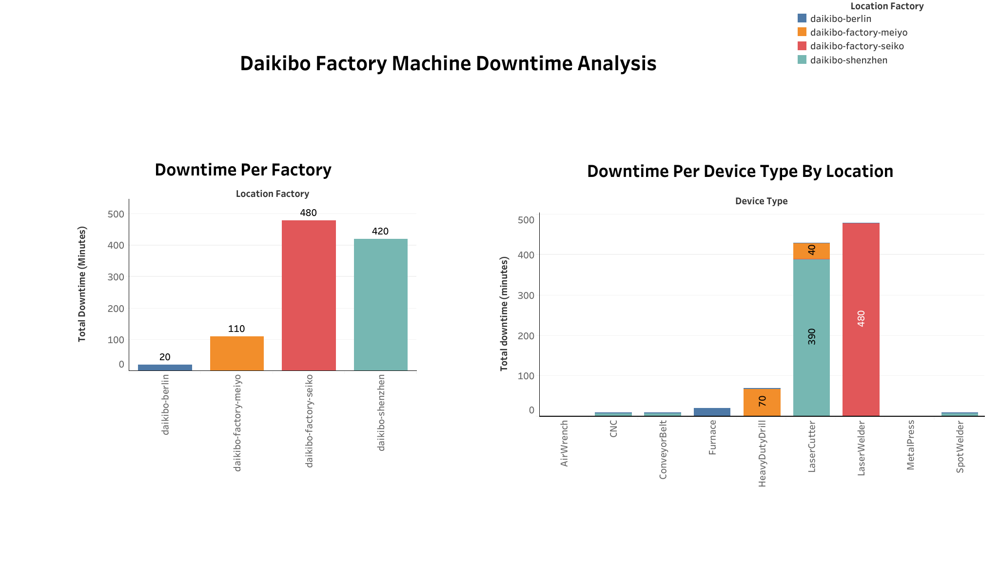
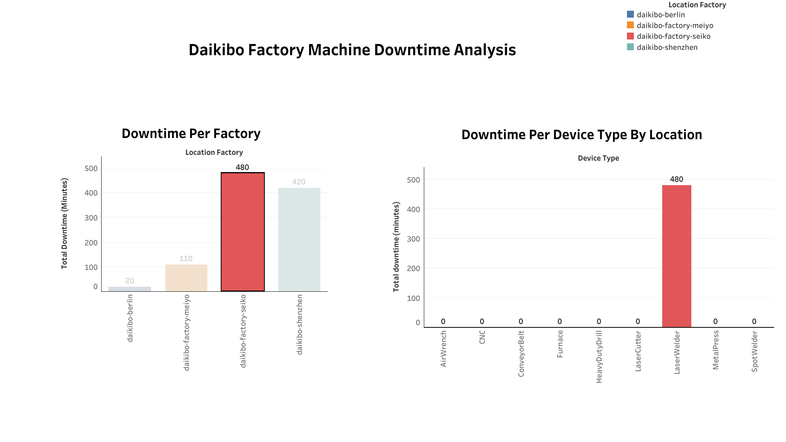

# Deloitte Australia Data Analytics Job Simulation (Forage)

**Daikibo Industrials: machine downtime dashboard and HR equality score classification**

**Tools:** Python (pandas), Tableau Public, Excel

**[View the interactive Tableau dashboard](https://public.tableau.com/views/Daikibo-Telemetry/Machine_Downtime_Analysis-DB)**

This repository contains my work for the [Deloitte Australia Data Analytics Job Simulation](https://www.theforage.com/simulations/deloitte-au/data-analytics-s5zy) on Forage. The simulation gives a fictional client, Daikibo Industrials, a manufacturing company with four factories, and asks for two pieces of work: a dashboard that shows where machines break down most, and a simple system for classifying HR equality scores.

## Key results

| Question | Answer |
|---|---|
| Which factory had the most machine downtime? | **Osaka (Daikibo Factory Seiko)** with 480 minutes, 46.6% of all downtime |
| Which machines caused it? | **Laser welders.** They caused all 480 minutes of downtime in Osaka |
| Which factory was next? | Shenzhen with 420 minutes (40.8%), 390 of them from laser cutters |
| How many equality scores were outside the fair range? | **18 of 37** (11 Unfair and 7 Highly Discriminative) |

## Task 1: Machine downtime dashboard (Python and Tableau)

### Business question

Daikibo's leadership wanted to know which factory had the most machine downtime, and which types of machines were behind it.

### Data

The data is a set of machine health readings, provided by Forage as a single JSON file (`daikibo-telemetry-data.json.zip`).

* 160,704 readings from 36 machines, 9 in each of 4 factories (Berlin, Osaka, Shenzhen and Tokyo)
* Each reading has the machine ID and type, the factory location, a status of `healthy` or `unhealthy`, and a temperature
* Location and status are nested inside each record, so the file has to be flattened before Tableau can use it

| Column | Meaning | Example |
|---|---|---|
| `deviceID` | Unique ID of the machine | `19ff3161-2b3a-40a3-8604-bdc6532d0dab` |
| `deviceType` | Type of machine | `LaserWelder`, `CNC`, `Furnace` |
| `timestamp` | Time of the reading, in milliseconds since 1970 (UTC) | `1619816400000` |
| `location_city` | Factory city | `osaka`, `tokyo`, `shenzhen`, `berlin` |
| `location_factory` | Factory name | `daikibo-factory-seiko` |
| `location_section` | Section of the factory | `section-1` |
| `data_status` | Machine health at the time of the reading | `healthy`, `unhealthy` |
| `data_temperature` | Machine temperature | `27` |

### What I did

1. **Flattened the JSON with Python.** [`flatten_telemetry.py`](flatten_telemetry.py) uses `pandas.json_normalize` to turn nested fields such as `location.city` into flat columns such as `location_city`, then saves a CSV file for Tableau.
2. **Calculated downtime.** Following the Forage instructions, machines report every 10 minutes, so each `unhealthy` reading counts as 10 minutes of downtime.
3. **Built a Tableau dashboard** with two bar charts: downtime per factory, and downtime per machine type. Clicking a factory in the first chart filters the second chart to that factory.



When Osaka is selected, the machine type chart shows that laser welders caused all of its downtime:



### Results

| Factory | Downtime | Share of total | Main cause |
|---|---|---|---|
| Osaka (Daikibo Factory Seiko) | 480 minutes | 46.6% | Laser welders (480 minutes) |
| Shenzhen | 420 minutes | 40.8% | Laser cutters (390 minutes) |
| Tokyo (Daikibo Factory Meiyo) | 110 minutes | 10.7% | Heavy duty drills (70 minutes) |
| Berlin | 20 minutes | 1.9% | Furnaces (20 minutes) |

Osaka and Shenzhen together caused 87% of all downtime, and in both factories almost all of it came from one type of laser machine. This points maintenance teams to a short list of machines to inspect first.

### Data quality check

While checking the data, I found that many readings repeat: each machine has 31 readings for every timestamp, and 134,703 rows are exact copies of another row. I followed the Forage method and counted every unhealthy row. As a check, I also counted each machine and timestamp only once. Osaka stays in first place (480 minutes) and Shenzhen second (370 minutes), so the conclusion does not change.

## Task 2: HR equality score classification (Excel)

### Business question

Daikibo's HR team had an equality score for each job role at each factory, but no simple way to tell which scores showed a problem.

### Data

`Equality Table.xlsx` has 37 rows, one for each job role at each factory, with three columns: `Factory`, `Job Role` and `Equality Score`.

### What I did

I added an `Equality class` column (in `Equality Table-solved.xlsx`) using this formula:

```excel
=IF(ABS(C2)<=10,"Fair",IF(ABS(C2)<=20,"Unfair","Highly Discriminative"))
```

`ABS` removes the minus sign, so a score of -15 and a score of 15 are treated the same way:

| Equality score | Class |
|---|---|
| -10 to 10 | Fair |
| -20 to -11, or 11 to 20 | Unfair |
| Below -20, or above 20 | Highly Discriminative |

### Results

| Class | Count | Share |
|---|---|---|
| Fair | 19 | 51% |
| Unfair | 11 | 30% |
| Highly Discriminative | 7 | 19% |

* **Management roles stand out.** 16 of the 17 management scores (C-Level, VP, Director, Sr. Manager, Manager and Jr. Manager) are outside the fair range.
* **Engineering and operator roles are all Fair.** All 16 scores for Engineers, Jr. Engineers, Sr. Engineers and Machine Operators are within the fair range.
* **Tokyo (Daikibo Factory Meiyo) has the most scores outside the fair range**, 7 of its 11 roles.
* All 18 scores outside the fair range are negative.

This tells HR to start its review with management roles, and with the Tokyo factory.

## Files in this repository

| File | What it is |
|---|---|
| `daikibo-telemetry-data.json.zip` | Raw machine data from Forage |
| `flatten_telemetry.py` | Python script that flattens the JSON into a CSV and prints a downtime summary |
| `Equality Table.xlsx` | Original HR equality scores from Forage |
| `Equality Table-solved.xlsx` | The same table with my `Equality class` column |
| `images/` | Screenshots of the Tableau dashboard |

### How to reproduce Task 1

```bash
pip install pandas
python flatten_telemetry.py
```

This creates `daikibo-telemetry-data.csv` (the file used in Tableau) and prints downtime by factory and by machine type.

## What I learned

* Flattening nested JSON data with pandas so it can be used in a BI tool
* Building an interactive Tableau dashboard where one chart filters another
* Checking data quality and testing whether a problem in the data changes the result
* Turning a business rule into a clear Excel formula

## Contact

**Kishan Patel** | [LinkedIn](https://www.linkedin.com/in/kishan-patel-kp1629) | [GitHub](https://github.com/kishanpatel1629) | [Tableau Public](https://public.tableau.com/app/profile/kishan.patel5786)
